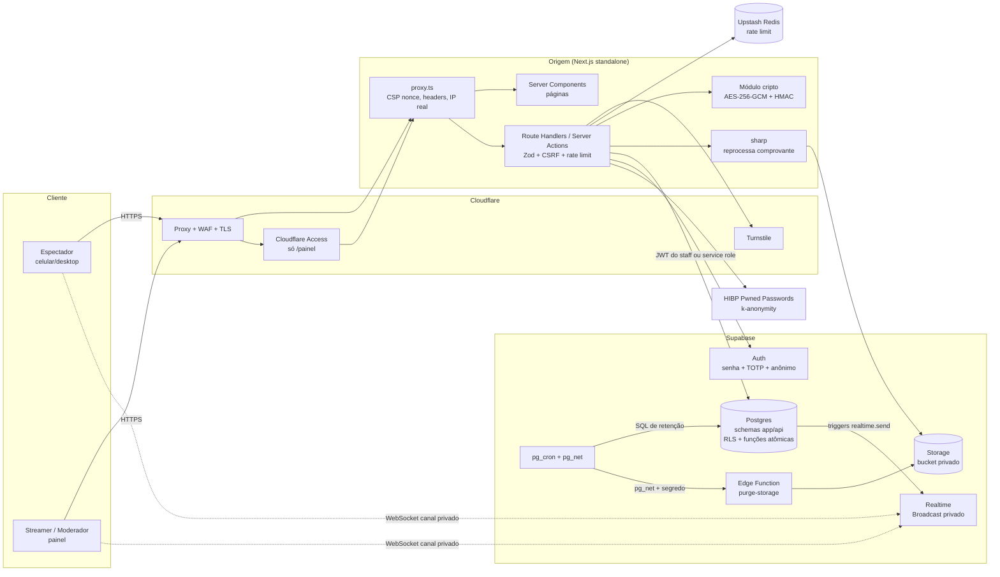
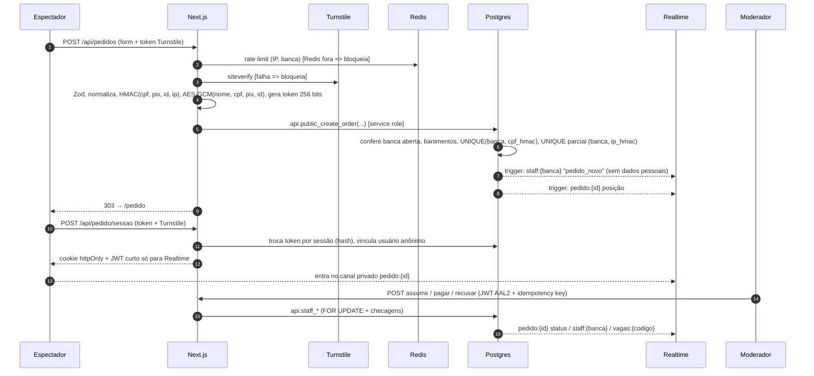
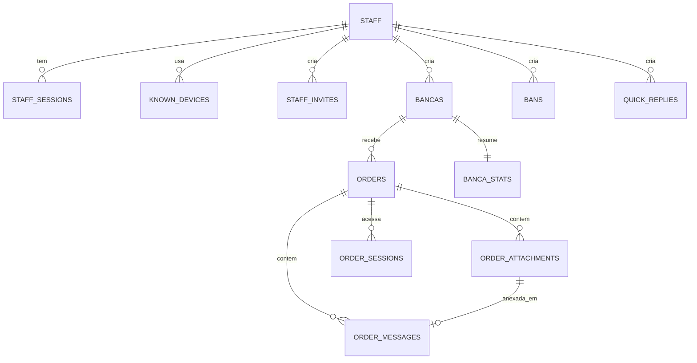
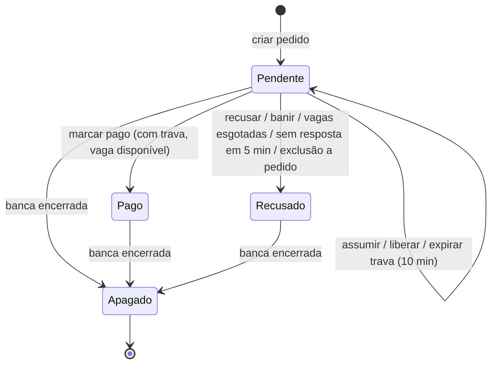
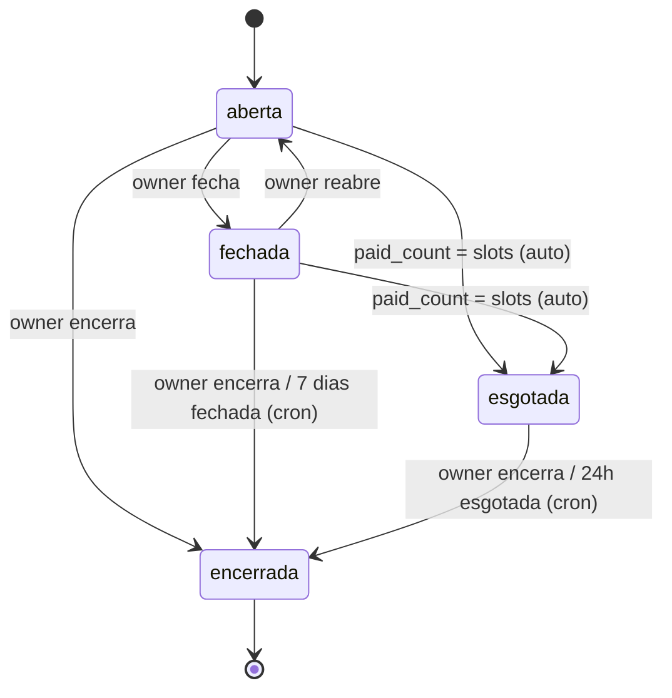

# ARCHITECTURE.md — Bancas do Pitchula

> **Status: APROVADA em 27/10/2026**, com as recomendações do `DECISIONS.md` aceitas e as alterações D-043 a D-047 incorporadas. Nenhum código foi escrito ainda.
> Este documento e o `DECISIONS.md` são a fonte da verdade entre as etapas. Toda mudança de arquitetura começa aqui.
> As referências **[DECIDIR]** que ainda aparecem no texto foram respondidas: vale a recomendação registrada no `DECISIONS.md`.

Legenda de maturidade, usada neste documento e nos relatórios das etapas:

| Marca | Significado |
|---|---|
| **Proposto** | Desenhado, ainda não implementado |
| **Implementado** | Código escrito |
| **Testado** | Coberto por teste automatizado que passou e cuja saída foi mostrada |
| **Pendente de configuração** | Depende de painel externo (Supabase, Cloudflare, Upstash, hospedagem) |
| **Não verificado** | Premissa sobre serviço externo que ainda precisa ser confirmada na prática |

Neste momento, tudo aqui está como **Proposto**.

---

## 1. Visão geral e componentes

### 1.1. Princípios

1. **O navegador nunca fala com as tabelas.** Toda leitura e escrita de dados passa pelo servidor Next.js. O navegador usa o Supabase **só** para o Realtime, com canais privados de Broadcast, e recebe apenas eventos que o servidor ou o banco escolheram emitir.
2. **Autorização em duas camadas.** O servidor confere papel, AAL2, sessão viva e inatividade. O banco confere de novo, com RLS e asserts dentro das funções. Se uma camada falhar, a outra continua barrando.
3. **Dados pessoais cifrados na aplicação.** A chave de cifra existe só no servidor Next.js. Quem tiver acesso apenas ao banco (incluindo um JWT de moderador usado direto na API do Supabase) vê somente o texto cifrado.
4. **Operações de estado são funções atômicas no Postgres**, com `SELECT … FOR UPDATE`, verificação do estado atual e chave de idempotência.
5. **Na dúvida, falhar fechado.** Se Redis, Turnstile, HIBP ou Supabase estiverem fora, as operações críticas são bloqueadas com mensagem amigável.
6. **Portabilidade.** O código não usa nada exclusivo de uma hospedagem. Nada de processo persistente próprio: tempo real fica no Supabase e agendamento no pg_cron.

### 1.2. Diagrama de componentes



### 1.3. Responsabilidades

| Componente | Faz | Não faz |
|---|---|---|
| `proxy.ts` (antigo middleware, Next 16) | Gera nonce de CSP, aplica headers, resolve IP real conforme `DEPLOY_MODE`, bloqueia `/painel` sem cookie de sessão | Não autoriza nada sozinho: só filtra o grosso |
| Route Handlers / Server Actions | Validação Zod, CSRF, rate limit, Turnstile, cifra/decifra, chamada às funções `api.*` | Nunca monta SQL; nunca loga dado pessoal |
| Postgres `app` (não exposto) | Tabelas, RLS, funções atômicas, triggers de Broadcast, auditoria | — |
| Postgres `api` (único schema exposto no PostgREST) | Wrappers finos: leituras `SECURITY INVOKER`, mutações `SECURITY DEFINER` com asserts | Não contém tabelas |
| Supabase Auth | Senha + TOTP do staff; sessão anônima do espectador, só para Realtime | Não recebe login direto do navegador |
| Realtime | Entrega eventos de Broadcast emitidos pelos triggers | Clientes não enviam nada (sem política de INSERT) |
| Storage | Guarda comprovantes reprocessados, acesso só por signed URL de 60 s | Sem acesso público |
| Edge Function `purge-storage` | Apaga arquivos da fila de exclusão pela API do Storage | Não tem a chave de cifra |
| Upstash Redis | Contadores de rate limit e bloqueio progressivo de login | Não guarda IP em claro: as chaves usam HMAC do IP |

### 1.4. Rotas

| Rota | Quem | Observações |
|---|---|---|
| `/` | Público | Tela inicial: "Aguardando banca..." com animação (D-044, D-047) |
| `/{codigo}-banca` (ex.: `/k7x9q2mb-4821-banca`) | Público | Página da banca: foto, valor, vagas em tempo real, formulário. Depois que a banca é encerrada, o código deixa de existir e a rota redireciona para `/` |
| `/pedido` | Dono do pedido | Lê `#TOKEN`, troca por cookie, apaga o fragmento. `Referrer-Policy: no-referrer`, `noindex`. Banca encerrada ou pedido inexistente: redireciona para `/` |
| `/privacidade` | Público | Política de privacidade |
| `/painel/entrar`, `/painel/mfa` | Staff | Login → TOTP (cadastro ou verificação) |
| `/painel/convite#TOKEN` | Convidado | Aceite de convite (token no fragmento, mesma técnica do pedido) |
| `/painel/**` | Staff AAL2 | Bancas, fila, chat, banidos, moderadores, sessões, auditoria |
| `/api/**` | Conforme a rota | Todas as mutações: Zod + CSRF + rate limit + autorização |

---

## 2. Fluxo de dados (resumo)



---

## 3. Modelo relacional

Convenções:
- Todas as tabelas ficam no schema `app`, que **não** é exposto no PostgREST. O schema `api` é o único exposto e só contém funções.
- PKs `uuid` geradas no servidor (`gen_random_uuid()`), exceto auditoria (`bigint identity`).
- Dinheiro em centavos (`bigint`). Datas em `timestamptz`.
- Colunas `*_enc` guardam `text` no formato `v{n}:{base64(iv‖ciphertext‖tag)}` (ver §6).
- Colunas `*_hmac` são `bytea` de 32 bytes, com `hmac_key_version smallint` ao lado.
- RLS **ativado** (`ENABLE ROW LEVEL SECURITY`) em todas as tabelas de `app`. Sem `FORCE`: as funções `SECURITY DEFINER` pertencem ao dono das tabelas e precisam escrever nelas, e o dono nunca é um papel usado pela aplicação (D-050).

### 3.1. Tipos

```sql
create type app.staff_role      as enum ('owner', 'moderator');
create type app.banca_status    as enum ('aberta', 'fechada', 'esgotada', 'encerrada');
create type app.order_status    as enum ('pendente', 'pago', 'recusado');
create type app.pix_key_type    as enum ('cpf', 'email', 'telefone', 'aleatoria');
create type app.refusal_reason  as enum ('vagas_esgotadas', 'banido', 'sem_resposta',
                                         'comprovante_ilegivel', 'deposito_nao_encontrado',
                                         'dados_divergentes', 'exclusao_a_pedido', 'outro');
-- 'banca_encerrada' não existe mais como motivo: encerrar apaga os pedidos na hora (D-044).
-- 'sem_resposta' = prazo de 5 min estourado (D-043).
create type app.ban_kind        as enum ('cpf', 'pix', 'platform_id', 'ip');
create type app.ban_scope       as enum ('global', 'banca');
create type app.msg_author      as enum ('espectador', 'staff', 'sistema');
```

"Em atendimento" **não é um estado**. É derivado: `status = 'pendente'` com trava ativa (`locked_by` preenchido e `lock_activity_at > now() - 10 min`). Assim as transições ficam mais simples e a trava expira sozinha, sem job.

### 3.2. Tabelas de staff e autenticação

**`app.staff`**: quem pode entrar no painel.

| Coluna | Tipo | Regras |
|---|---|---|
| `user_id` | uuid PK | FK → `auth.users(id)` ON DELETE CASCADE |
| `role` | `staff_role` | not null |
| `display_name` | text | 2–32 caracteres. É o apelido mostrado ao espectador ("Fulano está atendendo") |
| `active` | bool | default true |
| `created_by` | uuid | FK → staff |
| `created_at`, `deactivated_at` | timestamptz | |

Constraints: índice único parcial `on (role) where role = 'owner' and active`, garantindo **um único owner ativo**. Check `display_name ~ '^[\p{L}\p{N} ._-]{2,32}$'` (validado também no Zod).

**`app.staff_invites`**

| Coluna | Tipo | Regras |
|---|---|---|
| `id` | uuid PK | |
| `token_hash` | bytea unique | SHA-256 do token de 256 bits; o token em si nunca é gravado |
| `display_name` | text | apelido sugerido |
| `created_by` | uuid FK staff | só owner |
| `created_at` | timestamptz | |
| `expires_at` | timestamptz | check `expires_at <= created_at + interval '24 hours'` |
| `used_at`, `used_by` | timestamptz, uuid | uso único |
| `revoked_at` | timestamptz | |

Check: `not (used_at is not null and revoked_at is not null)`.

**`app.staff_sessions`**: complementa `auth.sessions`.

| Coluna | Tipo | Regras |
|---|---|---|
| `session_id` | uuid PK | = `auth.sessions.id` (claim `session_id` do JWT) |
| `user_id` | uuid FK staff | |
| `device_id` | uuid FK `known_devices` | |
| `created_at` | timestamptz | |
| `last_seen_at` | timestamptz | atualizado pelo servidor (no máximo 1×/min) |
| `live_mode` | bool | default **true** a cada login |
| `approx_location` | text null | país/cidade a partir dos headers da Cloudflare (só confiável em modos estritos) |
| `ua_summary` | text | ex.: "Chrome 141 · Windows" (sem UA completo) |
| `revoked_at`, `revoked_by` | timestamptz, uuid | |

Índice: `(user_id) where revoked_at is null`.

**`app.known_devices`**

| Coluna | Tipo | Regras |
|---|---|---|
| `id` | uuid PK | |
| `user_id` | uuid FK staff | |
| `device_hash` | bytea | HMAC do ID aleatório guardado num cookie httpOnly de longa duração |
| `first_seen_at`, `last_seen_at` | timestamptz | |

Unique `(user_id, device_hash)`.

**`app.auth_provisioning`**: pré-autorização de uso único (10 min) para o Supabase Auth criar uma conta com e-mail. Guarda só o SHA-256 do e-mail. Um trigger em `auth.users` recusa qualquer outra criação de conta não anônima (D-048).

**`app.security_alerts`**: alertas de dispositivo novo (e futuros alertas).

| `id` uuid PK | `user_id` uuid | `session_id` uuid | `kind` text (`novo_dispositivo`) | `created_at` | `acknowledged_at`, `acknowledged_by` |

### 3.3. Bancas

**`app.bancas`**

| Coluna | Tipo | Regras |
|---|---|---|
| `id` | uuid PK | |
| `code` | text null, unique | `^[a-z0-9]{8}-[0-9]{4}$` (a URL acrescenta `-banca`). Vira `NULL` no encerramento: o link deixa de existir (D-044) |
| `code_hash` | bytea unique | SHA-256 do código, mantido para que um código nunca seja reaproveitado |
| `name` | text | 1–80 caracteres, editável sempre |
| `total_cents` | bigint | `> 0` e `<= 100_000_000` (R$ 1 milhão; **[DECIDIR]** teto) |
| `slots` | int | `between 1 and 10000` |
| `per_person_cents` | bigint GENERATED | `total_cents / slots` (divisão inteira = arredonda para baixo) |
| `remainder_cents` | bigint GENERATED | `total_cents - per_person_cents * slots` |
| `ip_limit` | bool | default true |
| `status` | `banca_status` | default `aberta` |
| `paid_count` | int | default 0, check `paid_count between 0 and slots` |
| `order_count` | int | default 0 (trava edição de valor/vagas quando > 0) |
| `created_by` | uuid FK staff | |
| `created_at`, `closed_at`, `sold_out_at`, `ended_at` | timestamptz | |
| `ended_by` | uuid null | null = encerramento automático |
| `version` | int | concorrência otimista nas edições |

Depois de encerrada, a linha da banca continua só como **registro sem dados pessoais** (nome, valores e datas), para o resumo do streamer. Pedidos, mensagens, comprovantes e sessões são apagados na hora (D-044).

Checks:
- `total_cents >= slots` (valor por pessoa ≥ R$ 0,01)
- `status = 'encerrada'` ⇔ `ended_at is not null`
- `status = 'esgotada'` ⇒ `paid_count = slots`

Checks extras: `status = 'encerrada'` ⇔ `code is null`.

Índices: `(status)`, `(closed_at) where status = 'fechada'`, `(sold_out_at) where status = 'esgotada'`.

**`app.banca_stats`**: agregados guardados indefinidamente, sem dados pessoais. Mantidos pelos triggers.

| `banca_id` PK | `received` int | `paid` int | `refused` int | `total_paid_cents` bigint | `remainder_cents` bigint |

### 3.4. Pedidos e chat

**`app.orders`**

| Coluna | Tipo | Regras |
|---|---|---|
| `id` | uuid PK | gerado no servidor, porque entra como AAD da cifra |
| `banca_id` | uuid FK bancas | ON DELETE RESTRICT |
| `seq` | bigint identity | ordem de chegada global (desempate estável) |
| `status` | `order_status` | default `pendente` |
| `full_name_enc` | text | AES-GCM |
| `cpf_enc` | text | AES-GCM (CPF cadastrado na 4fly) |
| `pix_type` | `pix_key_type` | |
| `pix_key_enc` | text | AES-GCM |
| `platform_id_enc` | text | AES-GCM (ID na 4fly) |
| `cpf_hmac`, `pix_hmac`, `platform_id_hmac`, `ip_hmac` | bytea | HMAC-SHA256 dos valores normalizados |
| `hmac_key_version` | smallint | |
| `ip_unique` | bool | cópia de `bancas.ip_limit` no momento da criação |
| `access_token_hash` | bytea unique | SHA-256 do token de 256 bits |
| `token_revoked_at` | timestamptz | |
| `viewer_uid` | uuid null | usuário anônimo do Supabase vinculado (só para Realtime) |
| `locked_by` | uuid FK staff null | trava de atendimento |
| `locked_at`, `lock_activity_at` | timestamptz | |
| `reply_deadline_at` | timestamptz null | Prazo de resposta do espectador: `now() + 5 min` a cada mensagem do moderador que tem a trava. Volta a `NULL` quando o espectador responde (D-043) |
| `paid_by`, `paid_at` | uuid, timestamptz | |
| `refused_by`, `refused_at` | uuid, timestamptz | `refused_by` null quando a recusa é automática |
| `refusal_reason` | `refusal_reason` | |
| `refusal_note` | text | até 280 caracteres, opcional |
| `has_receipt` | bool | default false |
| `created_at`, `updated_at` | timestamptz | |

Constraints:
- `unique (banca_id, cpf_hmac)`: anti-duplicidade por CPF, garantida pelo banco
- `create unique index … on app.orders (banca_id, ip_hmac) where ip_unique`: 1 pedido por IP quando a opção estava ligada na criação
- `status = 'pago'` ⇒ `paid_at, paid_by not null`; `status = 'recusado'` ⇒ `refused_at, refusal_reason not null`
- `status <> 'pendente'` ⇒ `locked_by is null and reply_deadline_at is null`
- `reply_deadline_at is not null` ⇒ `locked_by is not null`

Índices: `(banca_id, status, seq)` para a fila; `(reply_deadline_at) where reply_deadline_at is not null` para o job de expiração; `(viewer_uid)`; `(locked_by) where locked_by is not null`; `(banca_id, pix_hmac)` e `(banca_id, platform_id_hmac)`, que servem de sinal antifraude no painel ("mesma chave Pix em outro pedido").

**`app.order_sessions`**: cookie do espectador.

| `id` uuid PK | `order_id` FK cascade | `session_hash` bytea unique | `created_at` | `last_seen_at` | `expires_at` | `revoked_at` |

**`app.order_messages`**

| Coluna | Tipo | Regras |
|---|---|---|
| `id` | uuid PK | |
| `order_id` | uuid FK cascade | |
| `author` | `msg_author` | |
| `staff_id` | uuid FK staff null | obrigatório quando `author = 'staff'` |
| `body` | text null | 1–1000 caracteres, sempre exibido como texto puro |
| `attachment_id` | uuid FK null | |
| `created_at` | timestamptz | |

Check: `body is not null or attachment_id is not null`. Índice: `(order_id, created_at)`.

**`app.order_attachments`**

| Coluna | Tipo | Regras |
|---|---|---|
| `id` | uuid PK | |
| `order_id` | uuid FK cascade | |
| `storage_path` | text unique | `comprovantes/{banca_id}/{order_id}/{uuid}.webp` |
| `bytes`, `width`, `height` | int | já após o reprocessamento |
| `sha256` | bytea | detecta comprovante reenviado em outro pedido (sinal antifraude) |
| `created_at` | timestamptz | |

Trigger `AFTER DELETE` → insere o caminho em `app.storage_purge_queue`.

**`app.storage_purge_queue`**

| `id` bigint identity | `storage_path` text | `enqueued_at` | `attempts` int | `last_error` text | `done_at` |

### 3.5. Moderação

**`app.bans`**

| Coluna | Tipo | Regras |
|---|---|---|
| `id` | uuid PK | |
| `kind` | `ban_kind` | |
| `value_hmac` | bytea | |
| `hmac_key_version` | smallint | |
| `scope` | `ban_scope` | |
| `banca_id` | uuid null | obrigatório quando `scope = 'banca'` |
| `reason` | text | 3–280 caracteres, **sem dados pessoais** (aviso na UI) |
| `source_order_id` | uuid null | sem FK, porque o pedido pode ser apagado antes do ban |
| `created_by`, `created_at` | | |
| `expires_at` | timestamptz null | |
| `review_due_at` | timestamptz null | `created_at + 12 meses` para cpf/pix/platform_id |
| `lifted_at`, `lifted_by` | | |

Checks:
- `kind = 'ip'` ⇒ `expires_at is not null and expires_at <= created_at + interval '7 days'` (vale para os dois escopos)
- `kind <> 'ip'` ⇒ `review_due_at is not null`
- `scope = 'banca'` ⇔ `banca_id is not null`

Índice para checagem rápida: `(kind, value_hmac) where lifted_at is null`.

**`app.quick_replies`**: `id`, `label` (até 40), `body` (até 500), `sort`, `active`, `created_by`. Seed inicial: "comprovante ilegível", "depósito não encontrado", "pago, boa sorte!".

### 3.6. Idempotência e auditoria

**`app.idempotency_keys`**

| `actor_id` uuid | `key` uuid | `action` text | `target_id` uuid | `result` jsonb | `created_at` |

PK `(actor_id, key)`. Limpeza pelo cron após 24h. Uma chave repetida com outra `action` ou outro `target_id` dá erro, e não replay.

**`app.audit_log`**: append-only.

| Coluna | Tipo | Regras |
|---|---|---|
| `id` | bigint identity PK | |
| `at` | timestamptz | default `now()` |
| `actor_id` | uuid null | null = sistema (cron) |
| `actor_role` | text | `owner`, `moderator`, `sistema` |
| `action` | text | enum lógico: `login`, `login_falhou`, `mfa_reset`, `sessao_revogada`, `assumir`, `liberar`, `forcar_assumir`, `pagar`, `recusar`, `banir`, `desbanir`, `revelar`, `copiar_pix`, `modo_live_off`, `banca_criar`, `banca_editar`, `banca_status`, `convite_criar`, `convite_revogar`, `moderador_remover`, `exclusao_dados`, … |
| `banca_id`, `order_id`, `target_user_id` | uuid null | sem FK, sobrevivem à exclusão dos dados |
| `detail` | jsonb | lista de chaves permitidas validada no servidor; nunca CPF, Pix, nome, token ou IP |
| `request_id` | uuid | correlaciona com o log do servidor |
| `prev_hash`, `row_hash` | bytea | encadeamento SHA-256 que torna adulteração evidente (ver DECISIONS D-019) |

Garantias:
- `REVOKE UPDATE, DELETE, TRUNCATE` de `anon`, `authenticated`, `service_role` e de todo papel usado pela aplicação
- Trigger `BEFORE UPDATE OR DELETE` que lança exceção, exceto dentro de `app.purge_audit_log()` (dona `postgres`, chamada só pelo pg_cron, apaga apenas `at < now() - 12 meses`)
- Inserção só pela função interna `app.audit(...)`, chamada pelas funções de negócio. Não existe política de INSERT para nenhum papel.
- Limite honesto: o superusuário do banco (dashboard do Supabase) consegue desabilitar triggers. O encadeamento de hash torna isso **detectável**, não impossível. Ver SECURITY.md (etapa 7).

### 3.7. Relacionamentos



---

## 4. Permissões

### 4.1. Identidades

| Identidade | Como se apresenta ao banco |
|---|---|
| Público (página da banca) | Servidor com service role chamando funções `api.public_*`. O navegador só tem a anon key para ler o canal `vagas:*` |
| Espectador | Para HTTP: cookie httpOnly → servidor com service role chamando `api.viewer_*(session_hash, …)`, e a própria função confere o hash. Para Realtime: JWT de usuário anônimo (`is_anonymous = true`) |
| Moderador / Streamer | JWT do Supabase (5 min) com `aal`, `session_id`. O servidor chama `api.staff_*` **com o JWT do usuário**, nunca com service role, para que RLS e asserts usem a identidade real |
| Cron | `postgres` via pg_cron |

### 4.2. Predicado central de staff

```sql
-- app.current_staff_role() → staff_role ou NULL
-- Verdadeiro somente se TODAS as condições valerem:
--   auth.jwt()->>'is_anonymous' não é 'true'
--   auth.jwt()->>'aal' = 'aal2'
--   existe app.staff ativo com user_id = auth.uid()
--   existe auth.sessions com id = (auth.jwt()->>'session_id')::uuid e user_id = auth.uid()
--   existe app.staff_sessions com esse session_id, revoked_at is null
--   e last_seen_at > now() - interval '8 hours'
-- SECURITY DEFINER, STABLE, search_path = ''
```

Essa função é a base de **toda** política de staff e de todo assert nas funções. Remover um moderador ou revogar uma sessão derruba o acesso **na próxima requisição**, mesmo com o JWT ainda válido.

### 4.3. Matriz de permissões

✅ = permitido · ❌ = negado (e testado como negado) · 🔒 = permitido com registro na auditoria

| Ação | Público | Espectador (dono) | Espectador (outro pedido) | Moderador AAL1 | Moderador AAL2 | Streamer AAL2 |
|---|---|---|---|---|---|---|
| Ver página da banca e vagas | ✅ | ✅ | ✅ | ✅ | ✅ | ✅ |
| Criar pedido | ✅ (Turnstile) | — | — | — | — | — |
| Ler pedido / status / posição | ❌ | ✅ | ❌ | ❌ | ✅ | ✅ |
| Ler e enviar mensagens do pedido | ❌ | ✅ | ❌ | ❌ | ✅ | ✅ |
| Enviar comprovante | ❌ | ✅ (só pendente) | ❌ | ❌ | ❌ | ❌ |
| Ver comprovante (signed URL) | ❌ | ✅ | ❌ | ❌ | ✅ | ✅ |
| Canal Realtime `pedido:{id}` | ❌ | ✅ | ❌ | ❌ | ❌ (usa `staff:*`) | ❌ |
| Canal Realtime `staff:{banca}` | ❌ | ❌ | ❌ | ❌ | ✅ | ✅ |
| Canal Realtime `vagas:{code}` (só leitura) | ✅ | ✅ | ✅ | ✅ | ✅ | ✅ |
| Enviar Broadcast em qualquer canal | ❌ | ❌ | ❌ | ❌ | ❌ | ❌ |
| Ver dados do espectador (modo live desligado) | ❌ | — | ❌ | ❌ | ✅ | ✅ |
| Revelar dado no modo live / copiar Pix | ❌ | — | ❌ | ❌ | 🔒 | 🔒 |
| Assumir / liberar atendimento | ❌ | ❌ | ❌ | ❌ | 🔒 | 🔒 |
| Forçar assumir de outro moderador | ❌ | ❌ | ❌ | ❌ | ❌ | 🔒 |
| Marcar pago / recusar | ❌ | ❌ | ❌ | ❌ | 🔒 (com a trava) | 🔒 |
| Banir | ❌ | ❌ | ❌ | ❌ | 🔒 | 🔒 |
| Desbanir | ❌ | ❌ | ❌ | ❌ | **[DECIDIR]** D-014 | 🔒 |
| Respostas rápidas: usar | ❌ | ❌ | ❌ | ❌ | ✅ | ✅ |
| Respostas rápidas: editar | ❌ | ❌ | ❌ | ❌ | ❌ | 🔒 |
| Criar/editar/fechar/reabrir banca | ❌ | ❌ | ❌ | ❌ | ❌ | 🔒 |
| Encerrar banca (apaga todos os dados dela, D-044/D-045) | ❌ | ❌ | ❌ | ❌ | 🔒 (confirmação digitando o nome) | 🔒 |
| Convidar/remover moderador, resetar MFA | ❌ | ❌ | ❌ | ❌ | ❌ | 🔒 |
| Ver/revogar sessões e alertas | ❌ | ❌ | ❌ | ❌ | só as próprias | 🔒 todas |
| Ler auditoria | ❌ | ❌ | ❌ | ❌ | ❌ | ✅ |
| Alterar/apagar auditoria | ❌ | ❌ | ❌ | ❌ | ❌ | ❌ |

Moderador em AAL1 só acessa `/painel/mfa` (cadastrar ou verificar TOTP) e `/api/auth/sair`.

### 4.4. Políticas RLS previstas

Todas as tabelas: `ENABLE ROW LEVEL SECURITY` (D-050). **Padrão negar.** `authenticated` só recebe `SELECT` (filtrado pelas políticas abaixo) e nunca escrita; `anon` e `service_role` não recebem nada nas tabelas. Nenhuma política para `anon`. Para `authenticated`, só as abaixo. `service_role` ignora RLS por definição do Supabase, por isso as funções chamadas com service role fazem as próprias checagens e têm `EXECUTE` concedido **somente** a `service_role`.

| Tabela | SELECT | INSERT / UPDATE / DELETE |
|---|---|---|
| `staff` | staff AAL2: todas as linhas ativas (apelidos); owner: todas | só via funções definer (owner) |
| `staff_invites` | owner | via função |
| `staff_sessions`, `known_devices`, `security_alerts` | próprio `user_id`; owner: todas | via função |
| `bancas`, `banca_stats` | staff AAL2 | via função (owner) |
| `orders` | staff AAL2 | via função |
| `order_messages`, `order_attachments` | staff AAL2 | via função |
| `order_sessions` | ninguém (nem staff) | via função |
| `bans` | staff AAL2 | via função |
| `quick_replies` | staff AAL2 | via função (owner) |
| `idempotency_keys`, `storage_purge_queue` | ninguém | via função / cron |
| `audit_log` | owner AAL2 | ninguém (trigger bloqueia UPDATE/DELETE) |

Mesmo nas leituras de staff, o JWT só enxerga `*_enc`. Sem a chave, que fica no servidor, o dado continua ilegível.

**Realtime (`realtime.messages`)**, com "Allow public access" **desligado** no projeto:

```sql
-- SELECT (receber) – authenticated
extension = 'broadcast' and (
     ( realtime.topic() like 'pedido:%'
       and app.viewer_owns_topic(realtime.topic()) )      -- viewer_uid = auth.uid(), token não revogado, sessão anônima
  or ( realtime.topic() like 'staff:%'
       and app.current_staff_role() is not null )
  or ( realtime.topic() like 'vagas:%' )
)
-- SELECT – anon: só realtime.topic() like 'vagas:%'   [Não verificado: confirmar na etapa 4 que o Realtime aceita política para o papel anon]
-- INSERT (enviar): NENHUMA política → nenhum cliente consegue emitir Broadcast.
-- Presence: nenhuma política.
```

Ponto de atenção: o enunciado fala em "canal público" para as vagas. Um canal público de verdade deixa **qualquer pessoa emitir** um número falso de vagas para todos os espectadores. Por isso a proposta é usar um canal **privado só de leitura** (D-008).

---

## 5. Fluxos principais

### 5.1. Login do staff

1. `/painel/entrar` mostra e-mail, senha e Turnstile. POST `/api/auth/entrar`.
2. Servidor: CSRF → rate limit por IP-HMAC e por e-mail-HMAC (Redis fora = bloqueia) → bloqueio progressivo (5 falhas: 1 min; 10: 15 min; 20: 1 h, por conta e por IP) → `signInWithPassword` **a partir do servidor**, com o token do Turnstile repassado ao captcha do Supabase Auth.
3. Sucesso em AAL1: cria `staff_sessions` (`live_mode = true`) e identifica o dispositivo pelo cookie `dev_id`. Se o dispositivo for novo, gera `security_alerts`. Grava os cookies de sessão httpOnly, Secure e SameSite=Strict, com prefixo `__Host-` (D-027). Audita `login`.
4. Redireciona para `/painel/mfa`. Sem fator TOTP: cadastro (QR + confirmação). Com fator: verificação. Ambos pelo servidor. Sessão sobe para **AAL2**.
5. O navegador nunca recebe o refresh token. Para o Realtime, `GET /api/auth/realtime-token` devolve só o access token atual (5 min), renovado pelo servidor.
6. Toda requisição do painel: servidor valida o JWT, `current_staff_role()`, `last_seen_at < 8h`, e atualiza `last_seen_at`.

### 5.2. Convite de moderador

1. Owner cria o convite. O servidor gera um token de 256 bits, grava o SHA-256 com `expires_at = now() + 24h` e mostra o link `/painel/convite#TOKEN` **uma vez**.
2. O convidado abre o link. A página lê o fragmento, apaga da barra e mostra o formulário (e-mail, senha ≥ 12, apelido, Turnstile).
3. Servidor: checagem HIBP por k-anonymity (`Add-Padding: true`). Senha vazada = recusa. **HIBP fora do ar = recusa com "tente de novo em instantes"** (falha fechada, D-012). Depois, `api.accept_invite(token_hash, …)` marca `used_at` **atomicamente** (`UPDATE … WHERE used_at IS NULL AND revoked_at IS NULL AND expires_at > now() RETURNING`). Só então o servidor cria o usuário com `auth.admin.createUser` (e-mail confirmado) e o registro em `staff`. Se a criação falhar, o convite é reaberto na mesma operação compensatória e o evento é auditado.
4. O novo moderador cai no login → MFA obrigatório.

### 5.3. Criação de banca

1. Owner AAL2 preenche nome, valor total, vagas e "limitar a 1 pedido por IP". A prévia é calculada no cliente (`floor(total/vagas)` e sobra), apenas como exibição.
2. `api.staff_create_banca(...)` com chave de idempotência. O servidor gera o código com `crypto.randomInt` (8 caracteres `[a-z0-9]` + 4 dígitos). Em colisão no `unique`, tenta de novo até 5 vezes.
3. O banco calcula `per_person_cents` e `remainder_cents` (colunas geradas, fonte da verdade).
4. Edição: nome sempre. `total_cents`, `slots`: a função recusa se `order_count > 0`. `ip_limit`: **[DECIDIR]** D-010.

### 5.4. Criação de pedido (público)

1. A página da banca é renderizada no servidor com nome, valor, vagas restantes e status. Se a banca estiver `fechada` ou `esgotada`, mostra o aviso e esconde o formulário. Código inexistente ou banca encerrada: redireciona para `/`.
2. Cliente: Zod com o mesmo schema do servidor, máscara de CPF, validação por tipo de chave Pix, checkbox de privacidade, declaração de maioridade (**[DECIDIR]** D-022) e Turnstile.
3. Servidor (nesta ordem): Origin/CSRF → rate limit (IP e banca; Redis fora = bloqueia) → Turnstile siteverify (falha ou indisponível = bloqueia) → Zod → normalização → HMACs → checagem de banimentos (cpf, pix, platform_id, ip; globais e da banca) → cifra → `api.public_create_order`.
4. A função no banco, em transação: `SELECT … FOR UPDATE` na banca → status `aberta` → teto de pendentes (D-032) → insere o pedido (os `unique` pegam CPF e IP) → `order_count += 1` → mensagem de sistema "Pedido recebido. Manda o print do comprovante aqui." → auditoria de sistema → triggers de Broadcast.
5. Qualquer bloqueio (banido, duplicado, IP, banca não aberta) devolve a **mesma** resposta genérica: "Não foi possível registrar seu pedido nesta banca." O motivo real vai só para o log do servidor, sem dados pessoais.
6. Resposta: 303 para `/pedido#TOKEN`.

Normalização antes do HMAC:
- CPF: só dígitos (11)
- Pix CPF: só dígitos
- Pix telefone: E.164 `+55DDNNNNNNNNN`
- Pix e-mail: trim + minúsculas
- Pix aleatória: UUID minúsculo
- ID na 4fly: trim + minúsculas
- IP: forma canônica, IPv6 agrupado no `/64` (D-011)
- Cada HMAC leva o domínio como prefixo (`cpf:`, `pix:`, `pid:`, `ip:`) para impedir colisão entre tipos.

### 5.5. Acesso do espectador ao pedido e tempo real

1. `/pedido` carrega com `Referrer-Policy: no-referrer` e `noindex`. O primeiro código da página (antes de qualquer script de terceiro) lê `location.hash`, guarda o token na memória e executa `history.replaceState`, removendo o fragmento (D-067).
2. Só então o Turnstile é carregado. POST `/api/pedido/sessao` com `{token, turnstile}`.
3. Servidor: rate limit por IP (Redis fora = bloqueia) → login **anônimo** no Supabase Auth com o token do Turnstile no captcha nativo → SHA-256(token) → `api.srv_open_order_session(token_hash, session_hash)`, que confere `token_revoked_at is null` → `api.srv_bind_viewer` vincula o usuário anônimo ao pedido → cookies `__Host-bp_ped` (sessão, 256 bits, só o hash fica no banco) e `__Host-bp_ped_rt` (refresh token do usuário anônimo), ambos httpOnly, Secure e SameSite=Strict. Token inválido: 404 e a conta anônima recém-criada é apagada.
4. `POST /api/pedido/estado` devolve estado, posição e chat. Os dados pessoais saem decifrados e **mascarados** (D-023): o valor completo nunca chega ao navegador.
5. `POST /api/pedido/realtime` renova a sessão anônima no servidor e devolve só o access token curto (5 min), a URL e a chave pública, para o navegador **ouvir** os canais privados `pedido:{id}` e `vagas:{código}`. A página renova 1 min antes de vencer. Sem Realtime, a página faz polling do estado (8 s; 60 s com o Realtime conectado).
6. `POST /api/pedido/mensagem` grava a resposta do espectador e zera o prazo de 5 min. Depois do prazo, o pedido é encerrado antes e a mensagem é recusada (409).
7. Revogar o token (ban ou exclusão, Etapa 5) apaga as `order_sessions`, zera `viewer_uid` e encerra a sessão anônima.

Eventos no canal `pedido:{id}` (payload mínimo):
- `status` → `{status, em_atendimento, atendente, motivo}`
- `posicao` → `{posicao}`
- `mensagem` → `{id, autor, texto, tem_anexo, criada_em}`
- `assumido` → `{atendente}`: o navegador toca o **beep** de "pedido assumido" (D-046)
- `prazo` → `{expira_em}` ou `{expira_em: null}`: contagem regressiva de 5 min na tela (D-043)
- `banca_encerrada` → `{}`: o navegador apaga o estado local e vai para `/` ("Aguardando banca...") (D-044)

Som (D-046): beep gerado pela Web Audio API (oscilador, sem arquivo de áudio). Os navegadores só liberam som depois de um toque na página, então o `/pedido` mostra o botão "Ativar som" logo na chegada. O primeiro toque em qualquer lugar da página também libera. No Android, o som vem junto com `navigator.vibrate`. A mensagem do moderador que inicia o prazo de 5 min toca um segundo beep, mais curto. Sem som liberado, o aviso aparece visualmente: título da aba piscando e destaque na tela.

A posição é recalculada no banco e enviada só a quem muda de lugar: o pedido novo (que entra no fim) e, quando um pendente sai da fila, os que estavam atrás dele (D-068). Teto e alternativa estão em D-009.

Prazo de 5 min (D-043): `app.expire_unanswered()` roda a cada 15 s no pg_cron e encerra (recusado, `sem_resposta`) o pedido cujo prazo venceu. Toda leitura ou mensagem do espectador também confere o prazo antes (checagem preguiçosa), então a regra vale mesmo se o job atrasar.

### 5.6. Atendimento



Funções (todas com `FOR UPDATE`, checagem de estado, `current_staff_role()`, idempotência e auditoria):

| Função | Regras |
|---|---|
| `api.staff_claim(order, idem)` | Pendente; trava livre **ou** expirada (`lock_activity_at < now()-10min`) **ou** já do próprio moderador. Grava `locked_by`, `locked_at`, `lock_activity_at`. Banca encerrada: erro |
| `api.staff_force_claim(order, idem)` | Só owner. Audita `forcar_assumir` com o moderador anterior |
| `api.staff_release(order, idem)` | Só quem tem a trava, ou owner |
| `api.staff_mark_paid(order, idem)` | Trava pelo próprio moderador (ou owner); `FOR UPDATE` **na banca primeiro**, depois no pedido (ordem fixa, evita deadlock); `paid_count < slots`; banca ≠ `encerrada`. Incrementa `paid_count`. Se `paid_count = slots`: banca → `esgotada`, `sold_out_at = now()` e **recusa automática** dos demais pendentes com `vagas_esgotadas` (D-004) |
| `api.staff_refuse(order, reason, note, idem)` | Pendente; trava pelo próprio moderador ou owner |
| `api.staff_send_message(order, body)` | Pendente com trava própria; renova `lock_activity_at`; define `reply_deadline_at = now() + 5 min` e emite `prazo` (D-043) |
| `api.viewer_post_message` / `viewer_add_attachment` | Pendente; zera `reply_deadline_at` e emite `prazo: null`. **Antes**, confere se o prazo já venceu: se sim, expira e recusa a mensagem |
| `app.expire_unanswered()` | Cron a cada 15 s (`pg_cron` com intervalo em segundos) + checagem preguiçosa em toda função do pedido. Pendentes com `reply_deadline_at < now()` → `recusado` com `sem_resposta`, trava liberada, auditoria de sistema, Broadcast |
| `api.staff_ban(...)` | Cria o ban e, se houver pedido de origem pendente, recusa com `banido` e revoga o token |

**Como ficou na Etapa 5:** os nomes reais das funções são `api.staff_claim`, `api.owner_force_claim`, `api.staff_release`, `api.staff_send_message`, `api.staff_mark_paid`, `api.staff_refuse`, `api.staff_ban`, `api.staff_lift_ban`, `api.staff_reveal` (revelar/copiar Pix), `api.staff_set_live_mode`, `api.staff_list_queue` e `api.staff_get_order`. Todas travam a banca e depois o pedido (`app.order_for_action`), aplicam a expiração do prazo antes e devolvem erros próprios (`BP001` pedido com outro moderador, `BP002` pedido finalizado, `BP003` sem vaga, `BP004` precisa assumir, `BP005` dado inválido). O streamer pode pagar ou recusar sem assumir quando ninguém está com o pedido (D-073). Os dados pessoais saem cifrados do banco; o servidor decifra e aplica o modo live.

**Prazo de resposta (D-043):** a contagem começa quando o moderador **que está com a trava** manda uma mensagem. Mensagem de texto ou comprovante do espectador para o relógio. Cada nova mensagem do moderador reinicia os 5 min. Liberar a trava, pagar ou recusar cancela o prazo. O espectador vê a contagem regressiva, e o moderador vê o tempo restante na fila. Expirar é uma recusa com o motivo "sem resposta". Pela D-007, isso **não** libera o CPF para um novo pedido na mesma banca, e o aviso na tela diz isso claramente.

**Pago sai da fila:** a fila do painel mostra só pendentes por padrão. Pagos e recusados ficam no filtro "Finalizados" e no resumo. O espectador continua vendo "Pago" até o encerramento da banca.

O que conta como atividade que renova a trava: enviar mensagem, revelar dado, copiar Pix, abrir comprovante. Ficar com a aba aberta **não** conta (D-016).

Concorrência garantida pelo banco:
- **Duas pessoas pagando a última vaga:** o `FOR UPDATE` na banca serializa as transações. A segunda vê `paid_count = slots` e falha. O `check (paid_count <= slots)` é a última linha de defesa.
- **Pagar duas vezes:** a segunda transação vê `status = 'pago'` e retorna o resultado guardado (mesma chave de idempotência) ou erro de transição.
- **Dois moderadores assumindo:** o `FOR UPDATE` no pedido; o segundo vê a trava ativa.
- **Recusado → pago:** a função exige `status = 'pendente'`.

### 5.7. Estados da banca



**Encerrar = apagar tudo na hora (D-044).** `api.staff_end_banca(banca, confirm_name, idem)` pode ser chamada pelo streamer ou por um moderador AAL2 (D-045). Em **uma transação**:
1. `FOR UPDATE` na banca. Confere `confirm_name = name` (o painel pede para digitar o nome da banca).
2. Fecha os agregados em `banca_stats` (recebidos, pagos, recusados, total pago, sobra).
3. Emite `banca_encerrada` em `vagas:{code}`, `staff:{banca}` e em cada `pedido:{id}`. Os navegadores conectados vão para `/` ("Aguardando banca...").
4. `DELETE` de todos os pedidos da banca (cascade: mensagens, anexos, sessões). O trigger dos anexos enfileira os arquivos.
5. `status = 'encerrada'`, `ended_at = now()`, `ended_by`, `code = NULL`: o link deixa de existir.
6. Auditoria `banca_encerrar`, com contagens e sem dados pessoais.
7. O servidor dispara o trabalhador de limpeza **na hora** (depois da resposta), sem esperar o cron. O cron de hora em hora fica como rede de segurança para o que falhar. **Implementação:** rota `POST /api/interno/limpeza` do próprio app em vez de Edge Function (D-075).

Os usuários anônimos ligados aos pedidos apagados vão para a fila `auth_purge_queue` e são removidos pelo mesmo trabalhador.

Cron a cada 5 min chama a mesma rotina como "sistema": `fechada` com `closed_at < now() - 7 dias`; `esgotada` com `sold_out_at < now() - 24h`; `aberta` sem pedido novo nem ação de atendimento há 7 dias (D-005).

### 5.8. Modo live

- `staff_sessions.live_mode = true` a cada login. **O mascaramento é feito no servidor:** com modo live ligado, a API de listagem e chat devolve `"J*** S***"`, `"***.***.***-**"` etc. e **nunca** o valor real. Inspecionar o DOM não revela nada.
- Revelar: `POST /api/painel/pedidos/{id}/revelar {campo}`. O servidor audita `revelar`, decifra e devolve só aquele campo. O cliente mostra por 5 s e mascara de novo; segurar o botão mantém visível por no máximo 15 s.
- Miniatura do comprovante: com borrão forte (CSS) e sem signed URL até revelar. Revelar gera uma URL de 60 s e audita.
- Copiar Pix: `POST /api/painel/pedidos/{id}/copiar-pix`. A resposta vai direto para `navigator.clipboard.writeText` sem passar pelo DOM visível. Audita `copiar_pix`.
- Desligar o modo live: confirmação explícita e auditoria `modo_live_off`. Volta a ligar em todo novo login.
- **Atalho de pânico** (padrão `Alt+Q`, D-017): a tela inteira vira neutra ("Painel oculto"), sem nenhum dado. O mesmo atalho volta.
- Mensagens do chat no modo live: sequências de 8+ dígitos, e-mails e telefones digitados pelo espectador são mascarados no servidor (D-015).

### 5.9. Banimento

1. Moderador escolhe tipo (cpf/pix/id/ip) e escopo. Para IP, a expiração é obrigatória e limitada a 7 dias. Informa o motivo.
2. A função usa os HMACs do pedido de origem: o moderador nunca digita o CPF. Para banir um valor avulso, o servidor normaliza e calcula o HMAC.
3. Pedido de origem pendente → recusado (`banido`), token revogado.
4. A lista de banidos mostra tipo, escopo, motivo, autor, datas e situação da revisão, **nunca o valor**. Os HMACs não são reversíveis.
5. Revisão anual: o painel sinaliza "revisão pendente" em `review_due_at`. **[DECIDIR]** o que acontece se ninguém revisar (D-020).

### 5.10. Uploads (comprovante)

1. `POST /api/pedido/comprovante` (multipart), com cookie do pedido, CSRF e rate limit (IP + pedido; Redis fora = bloqueia). Pedido precisa estar pendente. Máximo de 5 comprovantes por pedido (D-021).
2. Limite de 5 MB aplicado **durante a leitura do stream** (não depois). Confere os magic bytes: JPEG `FF D8 FF`, PNG `89 50 4E 47 0D 0A 1A 0A`, WEBP `RIFF....WEBP`. A extensão e o `Content-Type` do cliente são ignorados.
3. sharp com `limitInputPixels: 25_000_000`, `failOn: 'error'`, `sequentialRead`. Rejeita acima de 8000 px por lado. `rotate()` (aplica a orientação EXIF) → redimensiona para no máximo 2000 px → **re-encoda em WEBP** sem metadados.
4. Nome `uuid.webp` gerado no servidor. Upload com service role para o bucket privado `comprovantes`, e só então `api.viewer_add_attachment`.
5. Visualização: signed URL de 60 s, gerada sob demanda pelo servidor para o dono do pedido (cookie) ou para staff AAL2.

### 5.11. Exclusão de dados

**No encerramento** (imediata, D-044): ver §5.7. Os pedidos somem do banco na transação de encerramento, e os arquivos são apagados pela Edge Function logo em seguida.

**Automática** (pg_cron, a cada hora, como rede de segurança):
1. Sobrou algum pedido de banca `encerrada`? (não deveria) → `DELETE` e alerta no painel do streamer.
2. O pg_cron chama, via `pg_net`, a Edge Function `purge-storage` com um segredo compartilhado (guardado no Vault do Supabase) no header. A função lê a fila, apaga pela API do Storage em lotes, marca `done_at` e registra `last_error` com até 5 tentativas.
3. Bans de IP vencidos → apagados. Bans não-IP levantados há mais de 30 dias → apagados.
4. `audit_log` com mais de 12 meses → `app.purge_audit_log()`.
5. Usuários anônimos do Supabase sem pedido vinculado → apagados via `auth.admin.deleteUser` pela Edge Function.
6. `idempotency_keys` com mais de 24h, `order_sessions` expiradas.

**A pedido do titular:** no `/pedido` há um botão "Excluir meus dados" (D-018). Pendente → recusado (`exclusao_a_pedido`), depois apagado. Pago/recusado → dados pessoais apagados na hora; fica só a linha mínima para os agregados até o encerramento da banca. Pedidos por outros canais (e-mail de contato) são tratados pelo streamer no painel, com auditoria `exclusao_dados`.

**Teste obrigatório:** o arquivo precisa sumir de verdade do Storage (`download` retorna 404 depois do job).

---

## 6. Criptografia, chaves, tokens, logs

### 6.1. Cifra em repouso

- **Algoritmo:** AES-256-GCM (`node:crypto`), IV aleatório de 96 bits por valor e tag de 128 bits.
- **AAD:** `"{tabela}.{coluna}:{order_id}:v{n}"`. Isso impede copiar o texto cifrado de um pedido para outro ou de uma coluna para outra sem quebrar a autenticação.
- **Formato:** `v1:` + base64url(`iv ‖ ciphertext ‖ tag`).
- **Chaves:** `DATA_ENC_KEYS` = JSON `{"1":"<base64 32 bytes>", "2": …}` + `DATA_ENC_ACTIVE=2`. Cifra sempre com a ativa e decifra com a versão do prefixo.
- **Campos cifrados:** nome completo, CPF, chave Pix, ID na 4fly.

### 6.2. HMAC

- HMAC-SHA256 com `HMAC_KEYS` / `HMAC_ACTIVE` **separadas** das chaves de cifra.
- A checagem de duplicidade e de banimento calcula o HMAC com **todas as versões ativas** e compara com qualquer uma.
- **Rotação do HMAC é diferente da rotação da cifra:** os bans guardam só o HMAC, então não dá para recalcular sem o valor original. Procedimento: a nova versão passa a ser usada nas gravações, a antiga continua aceita nas checagens até o último ban dela expirar ou ser revisado, e os pedidos são recalculados (porque dá para decifrar). Detalhes em D-013.

### 6.3. Rotação (resumo do procedimento, que entra completo no SECURITY.md)

1. Gerar a nova chave (`openssl rand -base64 32`) e adicionar como versão N+1 sem ativar. Deploy.
2. Ativar N+1. Deploy. Novas gravações já usam N+1.
3. Rodar `pnpm rotate:data` (com `DATA_ENC_ACTIVE=N+1`): re-cifra em lotes, com transação por lote, retomável.
4. Conferir que não resta nenhum `vN:` (`select count(*) … like 'vN:%'`). Remover a chave N. Deploy.
5. Registrar a rotação no log de auditoria (ação de sistema).

### 6.4. Tokens

| Token | Tamanho | Guardado como | Transporte | Validade |
|---|---|---|---|---|
| Acesso ao pedido | 256 bits (`randomBytes(32)`, base64url) | SHA-256 | Fragmento `#` → POST → cookie | Até revogação ou exclusão dos dados |
| Sessão do pedido (cookie) | 256 bits | SHA-256 | Cookie `__Host-`, httpOnly, SameSite=Strict | Até o encerramento da banca (apagado junto com o pedido) |
| Convite | 256 bits | SHA-256 | Fragmento `#` | 24h, uso único |
| Dispositivo do staff | 128 bits | HMAC | Cookie httpOnly | 1 ano |
| CSRF | 256 bits | — | Cookie `__Host-bp_csrf` + header `x-csrf-token` (double submit, D-060) | Até fechar o navegador |

Comparações de hash em tempo constante (`timingSafeEqual`), quando feitas fora do banco.

### 6.5. Logs

- Logger estruturado (JSON) com **lista de campos permitidos**: qualquer campo fora da lista é descartado, não "mascarado".
- Nunca entram: corpo da requisição, headers `cookie`/`authorization`, fragmento, CPF, Pix, nome, ID na 4fly, IP em claro (só HMAC truncado para correlação), tokens, signed URLs.
- `request_id` em toda resposta de erro, para o usuário informar sem expor detalhes.
- Testes que fazem o fluxo inteiro e varrem a saída do logger procurando os valores de teste (CPF, chave, token).

### 6.6. Retenção

Mudou em 27/10/2026 (D-044): o enunciado previa 30 dias depois do encerramento, e agora o **encerramento apaga na hora**.

| Dado | Retenção | Mecanismo |
|---|---|---|
| Pedido (nome, CPF, Pix, ID), mensagens, sessões | Até o encerramento da banca (no máximo: 7 dias aberta sem movimento, 7 dias fechada, 24h esgotada) | Apagados na transação de encerramento |
| Comprovantes | Até o encerramento | Fila + trabalhador de limpeza chamado na hora (cron como rede de segurança, D-075) |
| Bans cpf/pix/id | Enquanto ativos; revisão a cada 12 meses | Só HMAC + motivo |
| Bans de IP | Até 7 dias | cron SQL |
| Auditoria | 12 meses | `purge_audit_log()` via cron |
| Agregados (`banca_stats`, `bancas`) | Indefinido | Sem dados pessoais |
| Usuários anônimos do Supabase | Até o encerramento da banca (sem pedido: 1 dia) | Fila + trabalhador de limpeza (D-075) |
| Rate limit (Redis) | TTL da janela (≤ 24h) | Chaves com HMAC do IP |
| Backups do Supabase | Conforme o plano (dados apagados persistem no backup até ele expirar) | Documentado no README e na política |

Os HMACs dos bans são **dados pseudonimizados, não anonimizados** (LGPD art. 13 §4º): quem tem a chave HMAC consegue testar se um CPF está banido. Continuam sujeitos à LGPD.

---

## 7. Modelo de ameaças

Ativos: dados pessoais (nome, CPF, Pix, ID, comprovantes), integridade do dinheiro (pagar quem não devia ou pagar além das vagas), contas do staff, reputação (site clonado).

| # | Ameaça | Cenário | Mitigações | Risco residual |
|---|---|---|---|---|
| T1 | **Vazamento durante a live** | O painel aparece na tela da transmissão (OBS capturando a janela errada) | Modo live ligado a cada login e mascarado **no servidor**; revelação temporária e auditada; Pix copiado sem exibir; atalho de pânico; chat com padrões mascarados; miniaturas borradas sem URL | O streamer desligar o modo live na live. Mitigado só por fricção (confirmação) |
| T2 | Link do pedido vazado | Espectador mostra o link no chat da Twitch ou manda print | Token no fragmento; trocado por cookie e apagado da barra; aviso explícito; revogável; o link só dá acesso ao **próprio** pedido | Quem pegar o link antes de ser revogado vê o status e o chat, mas os dados pessoais aparecem mascarados (D-023) |
| T3 | IDOR / acesso a outro pedido | Trocar IDs na API ou no tópico do Realtime | Espectador nunca envia `order_id`: o servidor deriva do cookie; RLS em `realtime.messages`; tópico checado contra `viewer_uid` | — |
| T4 | Chamadas diretas ao Supabase | Usar a anon key exposta para ler tabelas | `app` não exposto; `api` sem funções executáveis por `anon`; `anon` sem USAGE no schema `app`; RLS em todas as tabelas; dados cifrados | — |
| T5 | Broadcast forjado | Emitir "vagas: 0" ou status falso | Nenhuma política de INSERT; "Allow public access" desligado | — |
| T6 | Tomada de conta do staff | Senha vazada, phishing, força bruta | Senha ≥ 12 + HIBP; TOTP obrigatório; login só pelo servidor com rate limit e bloqueio progressivo; Turnstile; alerta de dispositivo novo; Cloudflare Access opcional | Phishing em tempo real de TOTP (sem WebAuthn). Recomenda-se o Cloudflare Access |
| T7 | Sessão roubada ou moderador removido | JWT ainda válido após remoção | `current_staff_role()` confere `auth.sessions` + `staff_sessions` + `active` em **toda** chamada; JWT de 5 min; Realtime desconecta quando o JWT expira | Até 5 min de recebimento de eventos do Realtime (sem dados pessoais) após a revogação |
| T8 | Pagamento duplicado ou além das vagas | Clique duplo, dois moderadores, requisição repetida | Funções atômicas com `FOR UPDATE`, checagem de estado, `check` no banco, idempotência | Erro humano no Pix (fora do sistema) |
| T9 | Fraude de espectador | Vários pedidos com CPFs diferentes, comprovante reaproveitado | `unique(banca, cpf_hmac)`; 1/IP opcional; sinais no painel (mesmo Pix, mesmo ID, mesmo `sha256` de comprovante em outro pedido); bans | Comprovante editado (conferência manual) |
| T10 | Spam / DoS no formulário | Bots | Turnstile no servidor; rate limit por IP e por banca; falha fechada | Ataque distribuído grande (Cloudflare WAF) |
| T11 | Upload malicioso | Polyglot, bomba de descompressão, EXIF com localização | Magic bytes; limite em stream; `limitInputPixels`; re-encode; nome aleatório; bucket privado | Vulnerabilidade no libvips (manter sharp atualizado) |
| T12 | XSS | Mensagem de chat com HTML/JS | Texto puro (React escapa; proibido `dangerouslySetInnerHTML` via lint); CSP com nonce, sem `unsafe-inline` em script | — |
| T13 | CSRF | Site de terceiros fazendo POST | SameSite + double-submit assinado + checagem de `Origin`/`Sec-Fetch-Site` | — |
| T14 | IP forjado | `CF-Connecting-IP` falso direto na origem | Só é aceito em `DEPLOY_MODE=cloudflare_locked` ou `tunnel`; nos demais, regras de IP são marcadas como enfraquecidas | Hospedagem gerenciada: 1/IP e bans de IP são **contornáveis** |
| T15 | Site clonado / golpe | Golpista copia o visual e pede "taxa" | Aviso no rodapé; link oficial na Twitch e no Instagram; nunca pedir pagamento | Fora do controle técnico |
| T16 | Vazamento do banco | Dump do Postgres ou backup | Cifra de aplicação; chaves fora do Supabase; HMACs com chave secreta | Comprometimento simultâneo do servidor Next (onde estão as chaves) |
| T17 | Comprometimento do servidor Next | RCE ou dependência maliciosa | Dependências mínimas e fixadas; `pnpm audit` no CI; standalone; service role só no servidor; staff opera com o próprio JWT | Acesso total aos dados enquanto durar o comprometimento |
| T18 | Adulteração da auditoria | Esconder um pagamento indevido | Append-only por grants + trigger; encadeamento de hash | Superusuário do banco (detectável, não impossível) |
| T19 | Indisponibilidade de dependências | Redis, Turnstile, Supabase ou HIBP fora | Falha fechada nas operações críticas; mensagens amigáveis; páginas estáticas continuam | A live fica sem receber pedidos durante a queda |
| T20 | Enumeração de bancas | Adivinhar códigos | ~54 bits por código (36⁸·10⁴) + rate limit + `noindex` | O link é divulgado na live, então não é segredo |
| T21 | Moderador malicioso | Revelar dados em massa | Revelação um a um, auditada; rate limit nas revelações; owner vê a auditoria | Moderador com modo live desligado vê os dados da fila que atende |
| T22 | Encerramento indevido | Moderador (ou conta roubada) encerra a banca no meio da live e apaga todos os pedidos | Confirmação digitando o nome da banca; AAL2; auditoria com autor; alerta no painel do streamer | **Irreversível**: os dados apagados não voltam (só o backup do Supabase, ver README) |
| T23 | Disputa após o encerramento | Espectador diz que não recebeu o Pix depois que a banca foi encerrada | O resumo agregado e a auditoria (quem pagou qual pedido, quando) permanecem | Sem dados pessoais, não dá para provar **para quem** foi o Pix pelo sistema; o comprovante fica no app do banco |
| T24 | Expiração injusta pelo prazo de 5 min | Espectador com o celular bloqueado não escuta o beep | Beep + vibração + título piscando + contagem visível; o prazo só começa com mensagem do moderador | Notificação com o celular bloqueado exigiria push notification (fora do escopo) |

---

## 8. Headers e CSP

```
Content-Security-Policy:
  default-src 'self';
  script-src 'self' 'nonce-{n}' 'strict-dynamic' https://challenges.cloudflare.com;
  style-src 'self' 'nonce-{n}';
  img-src 'self' data: blob: https://{projeto}.supabase.co;
  font-src 'self';
  connect-src 'self' https://{projeto}.supabase.co wss://{projeto}.supabase.co;
  frame-src https://challenges.cloudflare.com;
  frame-ancestors 'none'; base-uri 'none'; form-action 'self'; object-src 'none';
  upgrade-insecure-requests
Strict-Transport-Security: max-age=63072000; includeSubDomains; preload   (preload só após confirmar)
X-Frame-Options: DENY
X-Content-Type-Options: nosniff
Referrer-Policy: strict-origin  (no-referrer em /pedido e /painel/convite)
Permissions-Policy: camera=(), microphone=(), geolocation=(), payment=(), usb=(), clipboard-write=(self)
Cross-Origin-Opener-Policy: same-origin
```

A CSP com nonce exige renderização dinâmica, então páginas com nonce não são estáticas. `style-src` com nonce: Tailwind gera CSS em arquivo, então não há conflito. Atributos `style` inline são proibidos no lint.

---

## 9. Identidade visual (resumo técnico)

- `src/theme/theme.ts` + variáveis CSS em `globals.css`: cores, fontes, raio, logo e foto. Fonte única da verdade, consumida pelo `tailwind.config` via variáveis.
- Proposta tipográfica (D-024): **Big Shoulders Display** (900/800, condensada) para valor e títulos; **Instrument Sans** para texto; **IBM Plex Mono** para dados tabulares no painel. Todas via `next/font/google` (auto-hospedadas no build).
- Foto: `public/pitchula.jpg` (991×1088, sem EXIF), enviada em 27/10/2026. `object-position` padrão `52% 18%` (rosto), ajustável no tema.
- Paleta tirada da foto (D-025), com os contrastes medidos:

| Token | Cor | Uso | Contraste |
|---|---|---|---|
| `--bg` | `#0B0B0C` | Fundo | — |
| `--surface` | `#141414` | Painel, superfícies | — |
| `--fg` | `#F2EFEA` | Texto | 17,2:1 no fundo |
| `--fg-muted` | `#A39E96` | Texto secundário | 7,4:1 no fundo; 6,9:1 na superfície |
| `--accent` | `#EE781C` | Laranja da fumaça: botão, barra de vagas, foco | 6,9:1 no fundo |
| `--accent-fg` | `#0B0B0C` | Texto **sobre** o laranja | 6,9:1 (branco sobre o laranja dá só 2,9:1, reprovado) |

O logo da camiseta (ciano/roxo) **não** entra na paleta, para manter uma única cor de destaque e fugir do degradê roxo/azul.
- Tela inicial `/` ("Aguardando banca..."): fundo escuro com grain, a palavra em Big Shoulders Display e uma animação discreta (três pontos pulsando no laranja e uma linha fina de "varredura"), parada quando `prefers-reduced-motion` está ativo.
- Grain: SVG `feTurbulence` estático como `background-image`, opacidade ~4%. Por ser estático, não interfere em `prefers-reduced-motion`. As microinterações (foco, contador de vagas, botão carregando) são desligadas quando essa preferência está ativa.
- Layout: grid `45fr 55fr` no desktop, foto `object-fit: cover` com `object-position` ajustável no tema (rosto), degradê da cor de fundo para transparente na borda esquerda da foto (~120px). Celular: foto em banner de `40svh`, formulário com `margin-top: -3rem` sobre um degradê para o fundo.

---

## 10. Plano de implementação

Critério de pronto de **toda** etapa (com saída mostrada):
`pnpm lint && pnpm typecheck && pnpm test && pnpm test:db && pnpm build`. A partir da etapa 3, também `pnpm test:e2e`.

| Etapa | Entrega | Testes da etapa |
|---|---|---|
| **1. Fundação** | Repositório, pnpm, TS strict, ESLint (regras: sem `dangerouslySetInnerHTML`, sem `style` inline, sem `console`), Tailwind, `next.config` standalone, Supabase local (`supabase init`), migrations de todos os tipos, tabelas, índices, constraints, RLS, `current_staff_role()`, grants; `.env.example`; tema e fontes; versões fixadas no DECISIONS | pgTAP: RLS ativo em 100% das tabelas de `app`; `anon` e `service_role` sem nenhum privilégio de tabela; `authenticated` só com SELECT e sem acesso aos hashes de token; RLS com cada identidade (owner, moderador AAL1/AAL2, sessão revogada, inativa, apagada no Auth, staff desativado, anônimo); `api.*` sem `EXECUTE` para `anon`; constraints (`paid_count ≤ slots`, `unique(banca, cpf_hmac)`, check do ban de IP ≤ 7 dias, convite ≤ 24h, um único owner); auditoria rejeita UPDATE/DELETE |
| **2. Autenticação** | Login pelo servidor, Turnstile no login, bloqueio progressivo, MFA TOTP (cadastro e verificação), seed do owner (`pnpm seed:owner`), convites, HIBP, sessões próprias, revogação, inatividade de 8h, alerta de dispositivo novo, reset de MFA, rotas `/painel/*` protegidas | pgTAP: AAL1 negado em toda função `api.staff_*`; JWT com `session_id` apagado negado; staff `active=false` negado; `last_seen_at` > 8h negado; anônimo negado. Vitest: rate limit e bloqueio de login; Redis fora = login bloqueado; HIBP fora = senha recusada; convite usado, expirado ou revogado negado; moderador não convida nem remove |
| **3. Bancas e formulário** | CRUD de bancas, prévia, slug seguro, regra de edição, página pública completa (layout final, foto, fontes), Zod compartilhado, máscaras, Turnstile, criação de pedido, anti-duplicidade, bans aplicados na criação, cifra/HMAC | Vitest: validação de CPF (dígitos), Pix por tipo, normalização, slug (formato e aleatoriedade), cifra (ida e volta, adulteração detectada, AAD trocado falha). pgTAP: duplicado por CPF e por IP; edição de valor/vagas com pedido negada; banca não aberta recusa. E2E (Playwright): fluxo feliz no celular e no desktop; mensagem genérica em duplicidade; teclado; contraste (axe) |
| **4. Pedido e tempo real** | Token de pedido, troca por cookie, `replaceState`, anônimo + Realtime, triggers de Broadcast, posição na fila, chat do espectador, canal `vagas:`, tela inicial "Aguardando banca...", beep de "assumido" e de "prazo", contagem regressiva | pgTAP: políticas de `realtime.messages` (dono ✅, outro ❌, staff AAL1 ❌, insert ❌ para todos). Integração com Supabase local: cliente real tentando entrar em `pedido:{outro}` → recusado; tentativa de broadcast → recusada. Vitest: token revogado negado; fragmento ausente em logs. E2E: posição atualiza em tempo real; link do pedido some da barra; evento `assumido` dispara o som (AudioContext instrumentado no teste) e, sem som liberado, o aviso visual; `banca_encerrada` leva para `/` |
| **5. Painel** | Fila em tempo real (só pendentes por padrão), filtros, chat do moderador, travas, prazo de 5 min, pagar/recusar/banir, respostas rápidas, resumo, notificação sonora, modo live, atalho de pânico, gestão de moderadores | pgTAP **concorrente** (duas conexões, `dblink`): última vaga paga por dois; pagamento duplo; duas travas; expiração e recuperação da trava; recusado→pago negado. pgTAP do prazo: mensagem do moderador com a trava define o prazo; resposta do espectador zera; prazo vencido → `recusado/sem_resposta` pelo job **e** pela checagem preguiçosa; mensagem do espectador depois do prazo é recusada; moderador sem a trava não inicia prazo. Vitest: idempotência (replay devolve o mesmo resultado). E2E: modo live mascarado por padrão, revelação volta a mascarar e gera auditoria, pânico esconde tudo; moderador não vê gestão de bancas/moderadores **e** a API recusa |
| **6. Uploads, auditoria, retenção** | Upload com sharp, signed URLs, bans completos, encerramento com exclusão imediata, crons, Edge Function `purge-storage`, exclusão a pedido, purge da auditoria | Vitest: extensão falsa, PNG truncado, > 5 MB, 20000×20000 px, polyglot, EXIF removido de verdade. pgTAP: encerramento apaga pedidos, mensagens, anexos e sessões, zera `code`, grava `ended_at` e os agregados; confirmação com nome errado é recusada; moderador AAL2 pode encerrar e AAL1 não; cron encerra fechada > 7d, esgotada > 24h e aberta parada > 7d. Integração: arquivo **some do Storage** depois do encerramento; rota da banca encerrada redireciona para `/`; ban de IP > 7 dias impossível |
| **7. Endurecimento e entrega** | Revisão de segurança completa, Dockerfile (multi-stage, usuário não-root), CI GitHub Actions (Supabase local + tudo + `pnpm audit --audit-level high`), README com os 3 modos de deploy, SECURITY.md, relatório final | Testes de falha: Supabase, Redis e Turnstile fora (respostas seguras); CSRF sem token e de outra origem; headers presentes (teste de integração em cima do build); varredura de logs por dados pessoais; `pnpm audit` |

Cada etapa termina com: saída real dos comandos, lista do que está **implementado / testado / pendente de configuração / não verificado** e atualização deste arquivo e do DECISIONS.md.

---

## 11. Modos de deploy (prévia, detalhada no README da etapa 7)

| Garantia | 1. Hospedagem Node gerenciada (ex.: Hostinger) | 2. VPS + Docker + Nginx + HTTPS | 3. VPS + Cloudflare Tunnel |
|---|---|---|---|
| IP real confiável (`CF-Connecting-IP`) | **Não** (origem acessível sem passar pela Cloudflare; não verificado se há outros proxies) | **Sim**, se o firewall aceitar só as faixas da Cloudflare e o Nginx usar `real_ip` só delas | **Sim** (tráfego entra só pelo `cloudflared`) |
| Origem protegida contra acesso direto | Não verificado (depende da Hostinger) | Sim, com firewall + Authenticated Origin Pulls | Sim (nenhuma porta aberta) |
| Cloudflare Access efetivo no `/painel` | Parcial (contornável indo direto na origem); mitigado validando o JWT do Access no servidor (`CF_ACCESS_AUD`) | Sim + validação do JWT | Sim + validação do JWT |
| Regra 1 pedido/IP e bans de IP | **Enfraquecidas** (aviso no painel ao criar banca) | Confiáveis | Confiáveis |
| Docker necessário | Não (build `standalone` via GitHub) | Sim | Opcional |

`DEPLOY_MODE` ∈ {`managed`, `cloudflare_locked`, `tunnel`}. Em `managed`, o servidor usa o IP do socket (ou o primeiro proxy confiável configurado) e o painel mostra o selo "regras por IP enfraquecidas neste modo".
